<!-- Top: Animated Contribution Graph -->
<h3><code>Beast2074@github ~ $ ./contributions.sh --graph</code></h3>

  

<!-- Middle Grid: Aligned 2x2 Layout (Borderless) -->
<h3><code>Beast2074@github ~ $ whoami --details</code></h3>

 

  

<!-- Bottom: Links & Socials -->
<h3><code>Beast2074@github ~ $ ./links.sh</code></h3>

<b>Machine Learning Engineer · Applied Researcher · Innovator</b>

  
  

