<!-- animated contribution graph -->
<h3><code>Beast2074@github ~ $ ./contributions.sh</code></h3>

  

<!-- ascii portrait (left) + streak/numbers card (right) -->
<h3><code>Beast2074@github ~ $ whoami</code></h3>
<table>
  <tr>
    <td valign="top"></td>
    <td valign="top"></td>
  </tr>
</table>

  

<h3><code>Beast2074@github ~ $ ./links.sh</code></h3>

<b>Machine Learning Engineer · Applied Researcher · Innovator</b>

 

